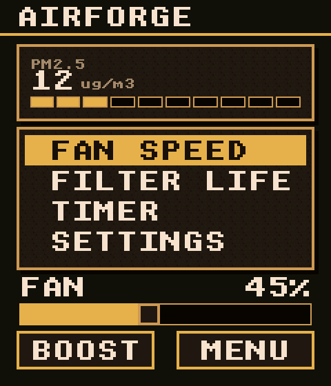
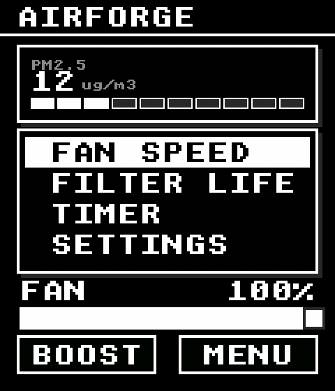
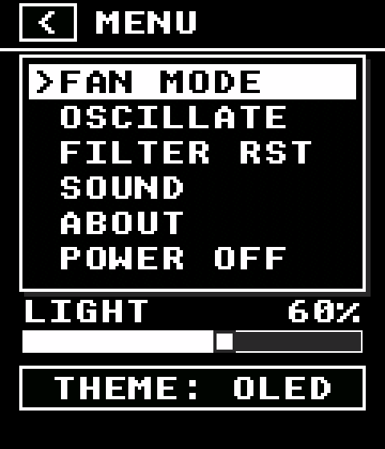

# AirForge

桌面焊接废气净化装置的固件与像素风 UI。基于 **ESP32-S3 + P169H002 240×280 触摸屏**，UI 使用 **LVGL 9.3** 编写，并可在 Windows / Linux 桌面上直接仿真。

`air forge -- clear the air at the desktop.`



## 功能特性

- **像素风 UI**：1bpp 像素字体（UNSCII 8/16）、硬阴影、2px 描边、噪点纹理
- **双主题**：`STONE`（石木暖色，泰拉瑞亚风格）与 `OLED`（纯黑单色高对比），运行时可切换
- **常用控件**：面板、按钮、列表、滑条、分段进度条，全部自绘
- **像素化动画**：8 帧阶梯式页面切换、选中块阶梯移动 + `>` 光标闪烁、概率条 10% 一档跳变、按钮 2px 按下位移
- **同一份 UI 源码**：桌面仿真与实机共用 `ui/`，不依赖任何平台 API

| STONE 主题 | OLED 主题 |
|---|---|
|  |  |
| |  |

## 硬件

| 部件 | 型号 / 参数 |
|---|---|
| 主控 | ESP32-S3-DevKitC-1（N16R8，16MB Flash + 8MB Octal PSRAM） |
| 屏幕 | P169H002，240×280 IPS，SPI，RGB565 |
| 触摸 | CST816T，I2C，地址 `0x15` |
| 固件框架 | ESP-IDF v6.1 |

引脚定义集中在 [`components/p169h002/include/board_pins.h`](components/p169h002/include/board_pins.h)：

| 功能 | GPIO | 功能 | GPIO |
|---|---|---|---|
| LCD SCLK | 12 | 触摸 SDA | 8 |
| LCD MOSI | 11 | 触摸 SCL | 9 |
| LCD CS | 13 | 触摸 INT | 10 |
| LCD DC | 14 | 触摸 RST | 18 |
| LCD RST | 15 | 背光 BL | 16 |

> 屏幕供电必须为 3.0–3.2V；转接板无 I2C 上拉，TSDA/TSCL 需各外接 4.7kΩ 上拉电阻。

## 目录结构

```
.
├── main/                   固件入口（app_main）
├── components/
│   └── p169h002/           屏幕 + 触摸板级驱动（SPI / I2C）
├── ui/                     ★ 平台无关的 LVGL 像素 UI
│   ├── widgets/            面板 / 按钮 / 列表 / 滑条 / 进度条
│   └── screens/            首页 / 设置页
├── sim/                    ★ 桌面仿真工程（SDL2）
│   ├── CMakeLists.txt      Windows 用本地 SDL2，Linux 用系统 SDL2
│   ├── lv_conf.h           LVGL 仿真配置
│   └── main.c              窗口、鼠标/键盘输入、整数缩放
├── scripts/
│   └── fetch_deps.py       拉取 LVGL（及 Windows 版 SDL2）到 third_party/
├── Doc/                    需求、硬件与开发文档
├── 3d_model/               风机结构模型（STEP）
└── .screenshots/           界面预览
```

## 快速开始

### 1. 桌面仿真（Windows）

前置：MinGW-w64 GCC、CMake ≥ 3.16、Python 3。

```powershell
python scripts/fetch_deps.py        # 下载 LVGL 9.3.0 + SDL2 2.32.10 到 third_party/
cmake -S sim -B sim/build -G "MinGW Makefiles" -DCMAKE_BUILD_TYPE=Debug
cmake --build sim/build -j 8
.\sim\build\air_forge_sim.exe
```

### 2. 桌面仿真（Linux / macOS）

```bash
# Debian / Ubuntu
sudo apt install build-essential cmake pkg-config libsdl2-dev
# macOS
# brew install cmake pkg-config sdl2

python3 scripts/fetch_deps.py --lvgl-only
cmake -S sim -B sim/build -DCMAKE_BUILD_TYPE=Debug
cmake --build sim/build -j
./sim/build/air_forge_sim
```

窗口为 240×280 的 2 倍整数放大（480×560）。鼠标左键 = 触摸，键盘 = 按键/编码器，滚轮 = 编码器旋转。

### 3. 烧录固件

```bash
. $IDF_PATH/export.sh
idf.py set-target esp32s3
idf.py build
idf.py -p /dev/ttyACM0 flash monitor     # Windows 下换成 COMx
```

固件入口目前仍走厂商 demo 路径（`app_main → p169h002_demo`），LVGL 显示/触摸驱动接入后将直接复用 `ui/`。

## 说明与限制

- `third_party/`、`build/`、`sdkconfig` 不纳入版本库；依赖用 `scripts/fetch_deps.py` 恢复。
- 界面文字使用 UNSCII ASCII 像素字体；中文显示需另行生成 CJK 像素字库（如 Zpix / 缝合像素字体）。
- 仿真依赖 SDL2；实机不依赖 SDL。
- 代码风格见 [.clang-format](.clang-format)。

## 文档

- [ESP32-IDF 开发文档](Doc/ESP32-IDF开发文档-v1.0.md)
- [需求文档：人机交互与硬件选型](Doc/需求文档-人机交互与硬件选型.md)
- [P169H002 屏幕资料](Doc/P169H002_lcd_screen.pdf)
- [ESP32-S3 参考手册](Doc/esp32s3n16r8_reference.pdf)

## 许可证

本项目采用 [MIT License](LICENSE)。
